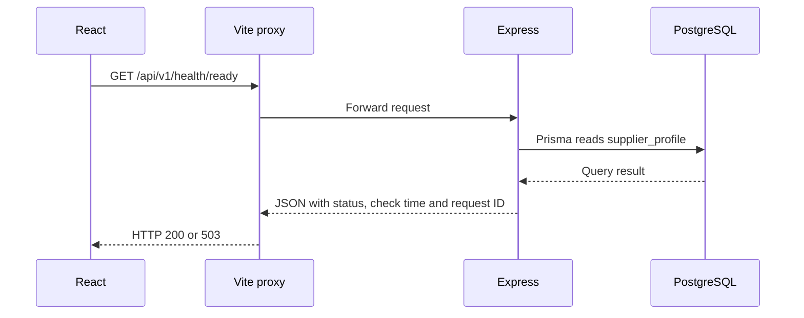

# OMS

A learning-first B2B order management system for a furniture wholesaler. The first milestone delivers an observable request from React through Express to PostgreSQL. The planned commercial workflow follows a hotel's order for 50 chairs, 20 desks and 10 cabinets.

## Run Milestone 1 locally

Use Linux, Node.js **24.22.3** with its bundled npm, Docker Engine and the Docker Compose plugin. Run the commands from the repository root. With nvm, `nvm install` and `nvm use` select the version in `.nvmrc`.

```sh
cp .env.example .env
```

Choose a local URL-safe password and replace the placeholder in both entries in `.env`. Compose uses `POSTGRES_PASSWORD` when it initializes an empty volume. Prisma reads `DATABASE_URL` to connect. Keep the values in sync. Existing volumes retain the password chosen at initialization.

```sh
npm ci
npm run setup
docker compose up -d --wait db
npm run db:migrate
```

Open two terminals at the repository root.

| Terminal | Command | Purpose |
|---|---|---|
| API | `npm run dev:api` | Express listens on loopback port 3001 and reloads source changes. |
| Web | `npm run dev:web` | Vite serves React on loopback port 5173 and proxies requests under `/api` to Express. |

Open **http://127.0.0.1:5173**. The page shows the result of a fresh database read, the check time and a request ID. Match the ID to the API terminal. All three services run on the same computer. Docker publishes PostgreSQL only on loopback port 5432.

## Trace the request



The React effect synchronizes the page with an external service on mount and on **Check again**. Cleanup aborts obsolete fetches. The shared Zod schema checks the network response at runtime. The UI derives its labels from one check result.

Express middleware creates a request ID before routing and logs the final status and elapsed time when the response finishes. The readiness handler awaits an injected database query. While PostgreSQL processes it, Node can serve another request. A successful read returns HTTP 200 even if the supplier table is empty. A missing table or failed connection returns HTTP 503 with a request ID. The liveness endpoint responds independently of PostgreSQL.

| Request | Meaning |
|---|---|
| `GET /api/v1/health/live` | Express is serving requests. |
| `GET /api/v1/health/ready` | Express can read the schema installed by the initial migration. |
| Unknown API route | JSON 404 carrying the request ID. |

## Exercise and acceptance check

1. Open the browser Network panel, select **Check again**, and match the `X-Request-Id` response header to the page and the API log.
2. Run the following sequence with the API and web terminals still running. Refresh the page after each database state change. Observe that the API can be reachable while the database is unavailable.

```sh
node scripts/check-readiness.mjs ready
docker compose stop db
node scripts/check-readiness.mjs unavailable
docker compose start --wait db
node scripts/check-readiness.mjs ready
```

3. Read the first migration and predict how the primary key and check constraint enforce one seller. Open a SQL session with `docker compose exec db psql -U oms -d oms` and run the equivalent of the readiness query.

```sql
SELECT id FROM supplier_profile LIMIT 1;
```

4. Place a breakpoint on `await checkDatabase()` in `apps/api/src/app.ts` using a VS Code JavaScript Debug Terminal running `npm run dev:api`. Step into the Prisma call. Explain why the browser still needs runtime validation when both workspaces use TypeScript.

**Interview question.** What happens to the Node.js event loop while a request awaits PostgreSQL, and why would a deployment check both liveness and readiness?

## Checks and project layout

```sh
npm run typecheck
npm test
npm run build
```

Run `npm run setup` after a fresh install or changes to the Prisma schema or shared contracts. It generates the Prisma client and builds the contract package. Supertest exercises the real Express routing stack with a controllable database probe. React Testing Library covers visible outage and retry behavior. CI also runs a real PostgreSQL migration, stops the database, and verifies recovery through Vite and the compiled API.

| Path | Responsibility |
|---|---|
| `apps/web` | React 19, Vite and Tailwind CSS v4. |
| `apps/api` | Express 5, Pino structured logs, Prisma ORM and committed SQL migrations. |
| `packages/contracts` | Runtime response validation and inferred TypeScript types. |
| `compose.yaml` | Local PostgreSQL 17 with a named data volume and a readiness probe. |

Stop the API and web terminals with Ctrl+C. Use `docker compose down` to stop the database and retain its data. Review Milestone 1 before starting staff access and permissions.

Licensed under the MIT License.
